 

<h2 align="center">🧠 我在做什么</h2>

  <b>LazyLearn</b> —— 把「刷题 → 模考 → AI 讲解 → 错题记忆」串成闭环的学习系统。

  学习者不缺题，缺的是<b>反馈密度</b>。 
  所以整套设计都把 agent 放在「出反馈」的位置上，人只负责最后一步判断。

<h2 align="center">🧩 两个客户端</h2>

  
  

🗂 在 Obsidian 里直接练题、归档错题、双向同步笔记　·　✍️ MarginNote 4 摘录一键成闪卡，带 AI 辅导与题库检索

<h2 align="center">📈 贡献</h2>

  

  

